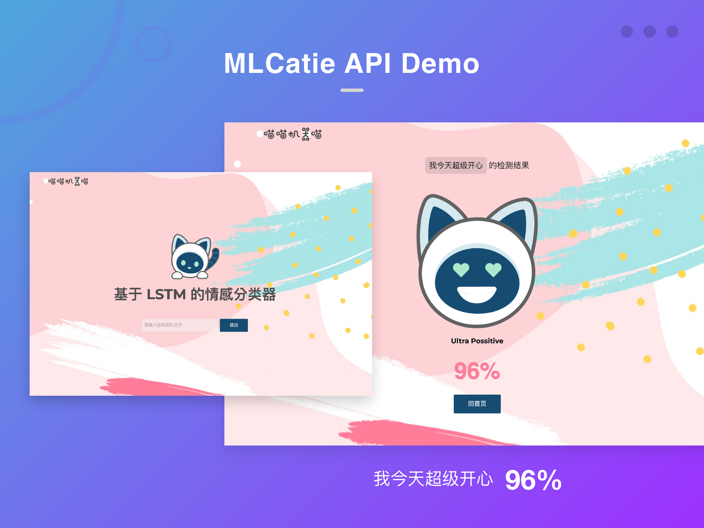
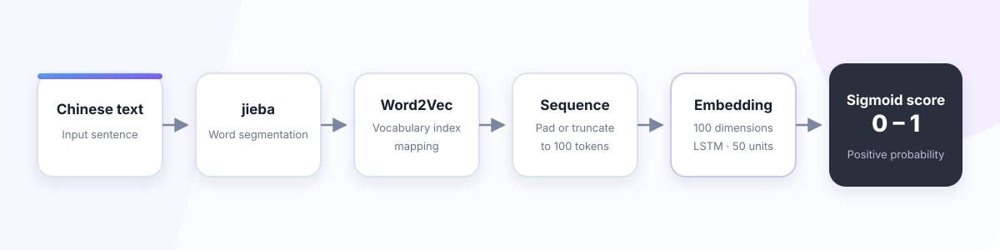

# Chinese LSTM Sentiment API

A Flask API for binary Chinese sentiment classification, developed as the model-service component of [MLCatie Emotion Chat](https://github.com/RocketWill/MLCatie-emotion-chatapp). The original system connects a `jieba` and Word2Vec preprocessing pipeline to a Keras LSTM model, then presents the predicted sentiment probability inside a realtime React/Firebase chat application.

## Project origin and recognition

MLCatie was developed as a team project in the 2019 Machine Learning course at Peking University's School of Software and Microelectronics. Under the Ministry of Education–Microsoft Industry-University Cooperative Education Program, the team was rated **Outstanding Team (优秀团队)** on 17 June 2019.

This was a collective course-project honor rather than a placing in an external Microsoft competition. Will Cheng's contributions covered the sentiment model, Flask API, React/Firebase chat interface, and realtime presentation of emotion scores.

## Demo



*The original web demo accepts Chinese text and maps the model probability to one of five visual sentiment levels.*

## Model pipeline



The saved model uses:

- `jieba` for Chinese word segmentation
- A saved Word2Vec vocabulary for token-to-index mapping
- Fixed-length sequences of up to 100 tokens
- A 100-dimensional embedding layer
- A 50-unit LSTM layer and 0.5 dropout
- A sigmoid output representing positive-sentiment probability

The five emotion levels shown in the UI are presentation bands over a binary model score; they are not five separately trained emotion classes.

## Historical experiment results

The original project presentation described an approximately 21,000-sample Chinese review corpus covering seven domains, with positive and negative examples divided into an 80/20 train/test split.

| Model | Test accuracy reported in the 2019 presentation |
| --- | ---: |
| SVM baseline | 0.83 |
| LSTM | 0.92 |

These values are retained as historical project results. The original dataset, its redistribution terms, and complete training logs are not included in this repository, so the figures have not been independently reproduced from the current checkout.

## Role in MLCatie

```text
React / Firebase chat client
          │
          │ Chinese message text
          ▼
Flask sentiment API
          │
          │ positive-sentiment probability
          ▼
Emotion indicator stored with the chat message
```

The companion client provides authentication, public channels, direct messages, realtime updates, presence, typing indicators, theme preferences, and image attachments. Its Firebase-hosted interface remains available at [mlcatie-emotion-chatapp.firebaseapp.com](https://mlcatie-emotion-chatapp.firebaseapp.com/), although the historical Heroku sentiment endpoint is no longer online.

## Historical API

The original client called the following endpoint:

```http
GET /api/<sentence>
```

Example response:

```json
{
  "msg": "我今天很開心",
  "prob": 0.92
}
```

The root route also includes a small server-rendered interface for submitting a sentence and viewing its sentiment level.

## Repository contents

```text
app.py                         Flask routes and historical API
lstm_code/Sentiment_lstm.py   Inference preprocessing and prediction
lstm_code/classify_mood.py    Five-level UI mapping
lstm_model/
├── Word2vec_model.pkl        Saved Word2Vec model
├── lstm.h5                   LSTM weights
└── lstm.yml                  Serialized Keras architecture
templates/                    Original server-rendered demo
static/                       Demo styles and visual assets
```

The current repository preserves the deployed inference implementation and model assets. The original project directory also contained LSTM training and SVM baseline source code, but the training dataset and complete experiment artifacts are not part of this checkout.

## Original technology stack

- Python and Flask
- TensorFlow 1.13.1 and Keras 2.2.4
- Gensim Word2Vec
- `jieba`
- NumPy and Pandas
- Gunicorn and Heroku for the historical deployment

## Running the historical implementation

The pinned dependencies reflect the 2019 environment and are not expected to install cleanly on a current Python runtime. With a compatible legacy environment:

```bash
pip install -r requirements.txt
python app.py
```

The service starts on `http://127.0.0.1:5000` by default. This repository preserves the original implementation; it is not presented as a current production API or a maintained reference architecture.

## Current status

- Model architecture, weights, and Word2Vec assets are preserved.
- The Firebase-hosted chat interface remains accessible.
- The original Heroku API deployment has been retired.
- Historical metrics are documented from the project presentation, not reproduced from this checkout.
- No runtime modernization is currently planned for this archived course project.

## License

This repository is licensed under the [Apache License 2.0](LICENSE).
